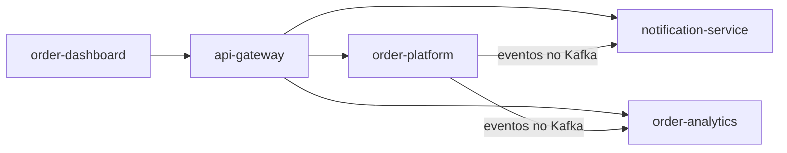

# Jhonatas de Freitas

Desenvolvedor de Software Full Stack. Trabalho com back-end em Java e Spring Boot e faço o front em React e TypeScript.

Gosto de entender como as partes de um sistema conversam: filas, eventos, o que acontece quando um serviço cai no meio do caminho. Os projetos abaixo são um sistema de pedidos que montei para estudar e mostrar isso na prática, do banco até a tela.

Tenho 25 anos e curso Análise e Desenvolvimento de Sistemas na PUC-RS e Tecnologia da Informação na UFMS.

## Projetos

Os cinco repositórios formam um sistema só. Cada um roda sozinho com `docker compose up`, e todos têm testes rodando no GitHub Actions.

| Projeto | O que é | Tecnologias |
|---|---|---|
| [order-platform](https://github.com/Jhonatas-de-Freitas/order-platform) | Três microsserviços (pedidos, estoque e pagamento) que conversam por eventos. Saga coreografada, outbox transacional, consumidor idempotente e fila de erros. | Java 21, Spring Boot, Kafka, PostgreSQL |
| [api-gateway](https://github.com/Jhonatas-de-Freitas/api-gateway) | Porta de entrada do sistema: login com JWT, limite de requisições por usuário e circuit breaker. | Spring Cloud Gateway, Keycloak, Redis, Resilience4j |
| [notification-service](https://github.com/Jhonatas-de-Freitas/notification-service) | Notificações por e-mail, SMS e push, com fila por canal, novas tentativas e agendamento. | Java 21, Spring Boot, RabbitMQ, PostgreSQL |
| [order-dashboard](https://github.com/Jhonatas-de-Freitas/order-dashboard) | Painel para acompanhar os pedidos em tempo real. Tem um modo de demonstração que roda direto no navegador. | React, TypeScript, Vite, Tailwind |
| [order-analytics](https://github.com/Jhonatas-de-Freitas/order-analytics) | Lê os eventos do Kafka e transforma em números: faturamento, cancelamentos, produtos mais vendidos. | Python, FastAPI, PostgreSQL |

Para ver funcionando sem instalar nada: [demonstração do painel](https://jhonatas-de-freitas.github.io/order-dashboard/).

## Tecnologias

  
  
  
  
  
  
  
  
  
  
  
  
  

Também uso no dia a dia: Next.js, Node.js, Supabase, Vercel, Prometheus e Grafana.

## Contato

- LinkedIn: [jhonatas-de-freitas](https://www.linkedin.com/in/jhonatas-de-freitas-1276a321b)
- E-mail: jhonatas.freitas@icloud.com
